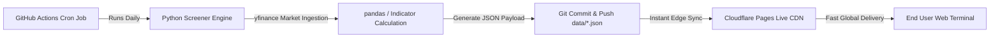

# Multi-Asset Market Intelligence & Quantitative Screener Terminal 📈

[](https://github.com/Ittipat10/market-intelligence-terminal/actions)
[](https://github.com/Ittipat10/market-intelligence-terminal/actions)
[](https://job-bangpla.pages.dev)
[](https://www.python.org/)
[](LICENSE)

An institutional-grade, dark-themed quantitative market screener and trading intelligence terminal. Powered by an automated asynchronous Python analytics pipeline, multi-asset technical indicator engines (EMA, RSI, MACD, Dual-Timeframe Trend Crossovers), and serverless 24/7 automated GitHub Actions CI/CD deployed to Cloudflare Pages.

---

## 🌐 Live Demos

- **Daily Screener Terminal**: [https://job-bangpla.pages.dev/](https://job-bangpla.pages.dev/)
- **Weekly & Monthly EMA 10 Trend Scanner**: [https://job-bangpla.pages.dev/weekly-monthly.html](https://job-bangpla.pages.dev/weekly-monthly.html)

---

## 🚀 Key Architectural Features

### 1. High-Performance Trading Terminal UI
- **Zero-Dependency Vanilla JS Engine**: Lightweight, instant loading (<150ms), and zero runtime framework bloat.
- **Bloomberg / TradingView Terminal Aesthetic**: Custom dark palette (`#090d16`), live market ticker strip, real-time clock, dynamic badge indicators, and interactive technical filters.
- **Bilingual Interface**: Native support for **Thai (TH)** and **English (EN)** with persistent user preferences via `localStorage`.

### 2. Multi-Asset Quantitative Coverage (450+ Assets)
- **US Equities**: S&P 500 Market Leaders (NVDA, AAPL, MSFT, TSLA, AMD, META, AMZN, etc.)
- **Thai Equities**: SET100 Benchmark Index (DELTA, PTT, CPALL, KBANK, AOT, GULF, BDMS, etc.)
- **Cryptocurrencies**: Top 100 High-Volume Assets (BTC, ETH, SOL, BNB, XRP, DOGE, AVAX, etc.)
- **Derivatives & Commodities**: TFEX S50 Index Futures, Gold Online, Silver, and Currency Futures.

### 3. Dual Analytical Rule Engines
1. **Daily Tactical Screener (`scanner.py`)**:
   - **Trend**: Exponential Moving Average (EMA 20) position & distance.
   - **Momentum**: Relative Strength Index (RSI 14) with overbought/oversold visual gauges.
   - **Signal**: Moving Average Convergence Divergence (MACD 12, 26, 9) histogram momentum and crossovers.
   - **Rule-based Decision Matrix**: Composite `BUY` / `WAIT` / `PASS` action signals with confidence scoring.

2. **Higher-Timeframe Trend & Crossover Screener (`scanner_weekly_monthly.py`)**:
   - **Multi-Timeframe Architecture**: Concurrently analyzes Weekly (1wk) and Monthly (1mo) candlestick structures.
   - **Primary Trend Indicator**: Dynamic EMA 10 crossover detection (`curr_close > curr_ema10` and `prev_close <= prev_ema10`).
   - **High-Probability Momentum Filter**: Detects when a fresh Weekly bullish crossover aligns with an established Monthly macro uptrend.

### 4. 24/7 Serverless Automated Data Pipeline
- **Multi-threaded Ingestion**: Concurrent execution (`concurrent.futures.ThreadPoolExecutor`) scanning hundreds of assets in under 60 seconds via `yfinance` & `pandas`.
- **Scheduled GitHub Actions**: Automated crons run daily across both engines to commit updated structured JSON snapshots.
- **Edge Deployment**: Cloudflare Pages automatically synchronizes and invalidates cache upon new commits.

---

## 📂 Project Structure

```text
├── index.html                           # Daily Screener Terminal UI (Tailwind CSS)
├── app.js                               # Frontend client engine, i18n & dynamic data tables
├── weekly-monthly.html                  # Weekly & Monthly EMA 10 Scanner interface
├── wm-app.js                            # Frontend logic for dual-timeframe trend scanner
├── scanner.py                           # Python technical screening engine (Daily)
├── scanner_weekly_monthly.py            # Python dual-timeframe trend crossover engine
├── requirements.txt                     # Core dependencies (yfinance, pandas, numpy)
├── data/
│   ├── scan-results.json                # Scanned data payload (Daily)
│   └── scan-results-wm.json             # Scanned data payload (Weekly/Monthly)
├── .github/
│   └── workflows/
│       ├── update-data.yml              # Daily automated GitHub Actions cron workflow
│       └── update-weekly-monthly.yml    # Dual-timeframe automated GitHub Actions workflow
└── README.md
```

---

## 🛠️ Local Development & Quick Start

### Prerequisites
- Python 3.10+
- Modern Web Browser

### 1. Clone the Repository
```bash
git clone https://github.com/Ittipat10/market-intelligence-terminal.git
cd market-intelligence-terminal
```

### 2. Install Dependencies
```bash
python3 -m venv venv
source venv/bin/activate  # On Windows: venv\Scripts\activate
pip install -r requirements.txt
```

### 3. Run the Scanners
```bash
# Run Daily Screener
python3 scanner.py

# Run Weekly & Monthly EMA 10 Screener
python3 scanner_weekly_monthly.py
```

### 4. Launch Local Web Server
```bash
python3 -m http.server 8000
```
Open [http://localhost:8000](http://localhost:8000) in your browser.

---

## ⚙️ CI/CD & Deployment Architecture



- **Zero Server Maintenance**: No expensive VPS or cloud servers required; runs entirely on free tier GitHub Actions + Cloudflare Pages.
- **Immutable Data Versioning**: Each market scan result is tracked with Git commit histories.

---

## 📄 License

This project is licensed under the [MIT License](LICENSE) - open for exploration, modification, and educational use.
